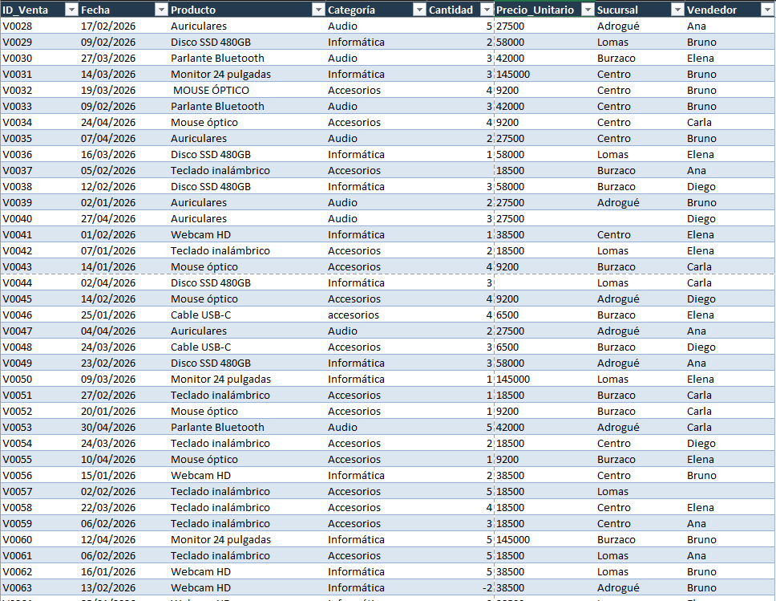
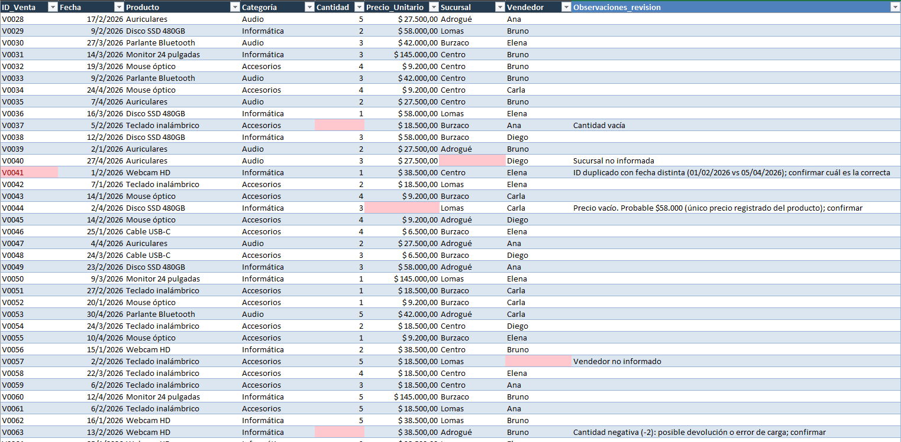
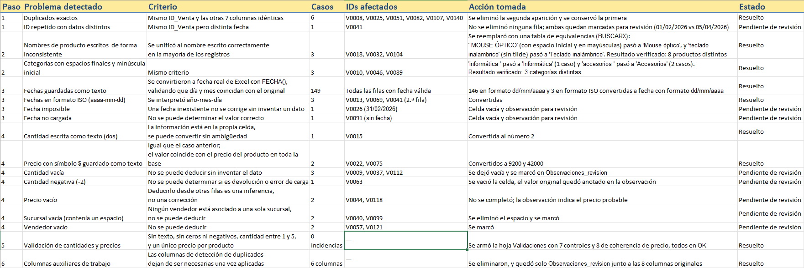

# Project 1 — Sales Data Cleaning in Excel

*Versión en español más abajo / Spanish version below → [Ir a la versión en español](#proyecto-1--limpieza-de-datos-de-ventas-en-excel)*

⬅️ [Back to the portfolio / Volver al portfolio](../README.md) — Project 1 of 5 / Proyecto 1 de 5

---

## 🇬🇧 English

### Overview

A fictional commercial company handed over a sales spreadsheet full of quality problems. The goal was to turn it into a reliable table that another analyst can use, **without losing traceability**: the original sheet is untouched, every change is documented, and nothing was invented.

> The dataset is fictional and was created for practice. It does not represent any real company.

### The rule that drove every decision

**Never invent missing data.** If a value can be determined from the cell itself, it is corrected. If it would have to be guessed or inferred from other rows, the cell is left empty and flagged for review.

### Process

| Step | Task | How |
|---|---|---|
| 1 | Find duplicates | Two-level criterion: same `ID_Venta` is a candidate; if the other 7 columns are identical it is an *exact duplicate*, otherwise a *conflict* |
| 2 | Normalize product and category names | Lookup table (original → correct), applied with `XLOOKUP` and a `"REVIEW"` fallback to catch unexpected values |
| 3 | Fix dates | All dates were stored as text. Rebuilt with `DATE()` and validated so impossible dates are flagged instead of silently rolling over |
| 4 | Detect blanks, invalid quantities and prices | Control table with `SUMPRODUCT`, `ISTEXT`, `COUNTIF` |
| 5 | Validate numbers | A `Validaciones` sheet with pass/fail controls |
| 6 | Build the clean base | `Datos_limpios` sheet, with an `Observaciones_revision` column for anything pending |
| 7 | Document changes | `Registro_de_cambios` sheet: problem, criterion, number of cases, affected IDs, action, status |

### Key decisions

| Case | Decision | Why |
|---|---|---|
| 6 exact duplicates | Removed the second occurrence, kept the first | Identical rows carry no extra information |
| `V0041`: same ID, different date | **Kept both rows and flagged** | Cannot tell which date is right; deleting one would lose information |
| Product / category spelling variants | Unified to the spelling already used by most rows | Each product always belongs to one category, so there was no ambiguity |
| 3 dates in `yyyy-mm-dd` format | Converted to real dates | The format is unambiguous |
| `31/02/2026` and `sin fecha` | Left empty, flagged | `DATE(2026,2,31)` silently returns 3 March, which would be an invented value. Day and month are checked against the original text |
| Quantity `"dos"`, prices `"$ 9200"` / `"$ 42000"` | Converted to numbers | The information is inside the cell itself |
| Quantity `-2` | Left empty, flagged | Could be a return or a data-entry error; cannot be determined |
| 2 empty prices | **Not imputed**, probable price noted in the observation | Each product has a single price in the whole base, but that is an inference from other rows, not a correction |
| Empty branch / seller | Left empty, flagged | Every seller sold in all four branches, so the branch cannot be deduced |

### Results

| Indicator | Before | After |
|---|---|---|
| Rows | 157 | 151 |
| Exact duplicates | 6 | 0 |
| Distinct products | 10 | 8 |
| Distinct categories | 5 | 3 |
| Dates stored as real dates | 0 | 149 |
| Quantities / prices stored as text | 3 | 0 |
| Rows flagged for review | — | 14 (13 sales) |

All 8 products have a single, consistent unit price, and every numeric control in the `Validaciones` sheet passes.

### Screenshots

**Before** — inconsistent names (`" MOUSE ÓPTICO"`, `"accesorios"`), blank cells, a negative quantity:

**After** — consistent values, real dates, and a review column explaining every empty cell:

**Change log** — every problem documented with criterion, cases and status:

### Files

| File | Description |
|---|---|
| [`data/Proyecto_1_Limpieza_Datos_Excel.xlsx`](data/Proyecto_1_Limpieza_Datos_Excel.xlsx) | Final workbook (see sheets below) |
| [`data/datos_limpios.csv`](data/datos_limpios.csv) | The clean table as CSV (UTF-8), previewable on GitHub |

Workbook sheets: `LEEME` (brief), `Registro_de_cambios` (change log), `Datos_originales` (untouched), `Datos_limpios` (clean data), `Aux_diagnostico` (working tables and lookup tables), `Validaciones` (validation controls), `Antes_Despues` (before/after summary).

### Skills demonstrated

Excel tables and structured references · `COUNTIF`, `SUMPRODUCT`, `TEXTJOIN`, `XLOOKUP`, `UNIQUE`, `LET`, `DATE`, `LEFT`/`MID`/`RIGHT`, `VALUE`, `TRIM`, `MINIFS`/`MAXIFS`, `IF`/`AND`, `ISNUMBER`/`ISTEXT` · absolute vs. relative references · data validation mindset · documenting decisions so they are reproducible and justifiable.

### Pending review

14 rows (13 sales) are flagged in `Observaciones_revision`. They need information that is not in the dataset (for example, the correct date for `V0041` or the real price list).

---

## 🇪🇸 Español

# Proyecto 1 — Limpieza de datos de ventas en Excel

### Resumen

Una empresa comercial ficticia entregó una planilla de ventas con muchos problemas de calidad. El objetivo fue convertirla en una tabla confiable para que otra persona pueda analizarla, **sin perder trazabilidad**: la hoja original no se modifica, cada cambio queda documentado y no se inventó ningún dato.

> El dataset es ficticio y fue creado para practicar. No representa a ninguna empresa real.

### La regla que guió cada decisión

**No inventar datos faltantes.** Si un valor se puede determinar a partir de la propia celda, se corrige. Si habría que adivinarlo o deducirlo de otras filas, la celda se deja vacía y se marca para revisión.

### Proceso

| Paso | Tarea | Cómo |
|---|---|---|
| 1 | Encontrar duplicados | Criterio en dos niveles: mismo `ID_Venta` es candidato; si las otras 7 columnas son idénticas es un *duplicado exacto*, y si no, un *conflicto* |
| 2 | Normalizar productos y categorías | Tabla de equivalencias (original → correcto), aplicada con `BUSCARX` y un valor `"REVISAR"` para detectar casos inesperados |
| 3 | Corregir fechas | Todas estaban guardadas como texto. Se reconstruyeron con `FECHA()` y se validaron para que las fechas imposibles se marquen y no se "corrijan" solas |
| 4 | Detectar vacíos, cantidades y precios inválidos | Tabla de control con `SUMAPRODUCT`, `ESTEXTO`, `CONTAR.SI` |
| 5 | Validar los números | Hoja `Validaciones` con controles de aprobado/revisar |
| 6 | Armar la base limpia | Hoja `Datos_limpios`, con una columna `Observaciones_revision` para lo pendiente |
| 7 | Documentar los cambios | Hoja `Registro_de_cambios`: problema, criterio, cantidad de casos, IDs afectados, acción y estado |

### Decisiones clave

| Caso | Decisión | Motivo |
|---|---|---|
| 6 duplicados exactos | Se eliminó la segunda aparición y se conservó la primera | Las filas idénticas no aportan información extra |
| `V0041`: mismo ID, distinta fecha | **Se conservaron ambas filas y se marcaron** | No se puede saber cuál fecha es la correcta; borrar una perdería información |
| Variantes de escritura de productos y categorías | Se unificaron a la forma que ya usaba la mayoría de las filas | Cada producto pertenece siempre a una categoría, no había ambigüedad |
| 3 fechas en formato `aaaa-mm-dd` | Se convirtieron a fechas reales | El formato es inequívoco |
| `31/02/2026` y `sin fecha` | Se dejaron vacías y se marcaron | `FECHA(2026;2;31)` devuelve en silencio el 3 de marzo, que sería un dato inventado. Se comprueban día y mes contra el texto original |
| Cantidad `"dos"`, precios `"$ 9200"` y `"$ 42000"` | Se convirtieron a número | La información está dentro de la propia celda |
| Cantidad `-2` | Se dejó vacía y se marcó | Puede ser una devolución o un error de carga; no se puede determinar |
| 2 precios vacíos | **No se completaron**; el precio probable quedó anotado en la observación | Cada producto tiene un único precio en toda la base, pero eso es una inferencia a partir de otras filas, no una corrección |
| Sucursal o vendedor vacíos | Se dejaron vacíos y se marcaron | Todos los vendedores vendieron en las cuatro sucursales, por lo que la sucursal no se puede deducir |

### Resultados

| Indicador | Antes | Después |
|---|---|---|
| Filas | 157 | 151 |
| Duplicados exactos | 6 | 0 |
| Productos distintos | 10 | 8 |
| Categorías distintas | 5 | 3 |
| Fechas guardadas como fecha real | 0 | 149 |
| Cantidades y precios guardados como texto | 3 | 0 |
| Filas marcadas para revisión | — | 14 (13 ventas) |

Los 8 productos tienen un único precio unitario coherente, y todos los controles numéricos de la hoja `Validaciones` se cumplen.

### Capturas

**Antes** — nombres inconsistentes (`" MOUSE ÓPTICO"`, `"accesorios"`), celdas vacías, una cantidad negativa:

**Después** — valores consistentes, fechas reales y una columna de revisión que explica cada celda vacía:

**Registro de cambios** — cada problema documentado con criterio, casos y estado:

### Archivos

| Archivo | Descripción |
|---|---|
| [`data/Proyecto_1_Limpieza_Datos_Excel.xlsx`](data/Proyecto_1_Limpieza_Datos_Excel.xlsx) | Libro final (hojas abajo) |
| [`data/datos_limpios.csv`](data/datos_limpios.csv) | La tabla limpia en CSV (UTF-8), con vista previa en GitHub |

Hojas del libro: `LEEME` (consigna), `Registro_de_cambios`, `Datos_originales` (sin tocar), `Datos_limpios`, `Aux_diagnostico` (tablas de trabajo y de equivalencias), `Validaciones` y `Antes_Despues` (resumen de calidad).

### Habilidades aplicadas

Tablas de Excel y referencias estructuradas · `CONTAR.SI`, `SUMAPRODUCT`, `UNIRCADENAS`, `BUSCARX`, `UNICOS`, `LET`, `FECHA`, `IZQUIERDA`/`EXTRAE`/`DERECHA`, `VALOR`, `ESPACIOS`, `MIN.SI.CONJUNTO`/`MAX.SI.CONJUNTO`, `SI`/`Y`, `ESNUMERO`/`ESTEXTO` · referencias absolutas y relativas · mentalidad de validación de datos · documentación de decisiones para que sean reproducibles y justificables.

### Pendiente de revisión

14 filas (13 ventas) quedaron marcadas en `Observaciones_revision`. Necesitan información que no está en el dataset (por ejemplo, la fecha correcta de `V0041` o la lista de precios real).
