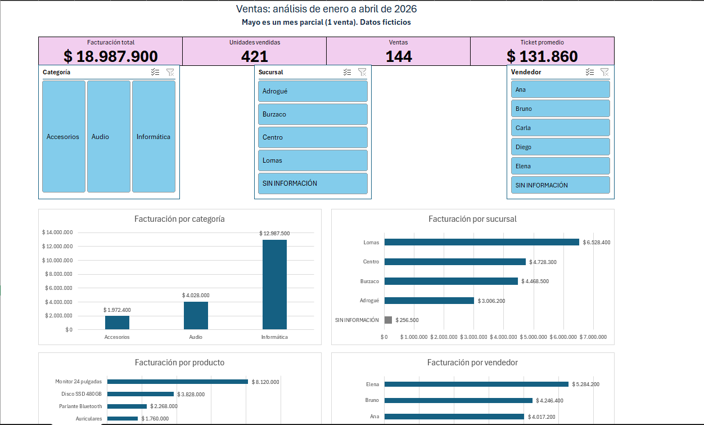
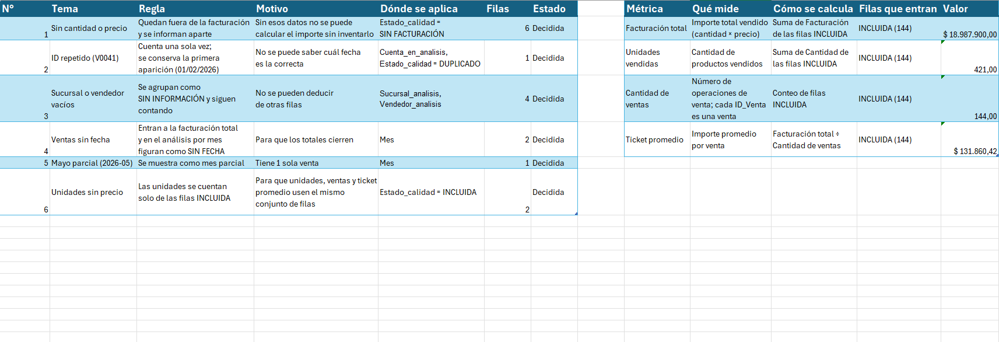
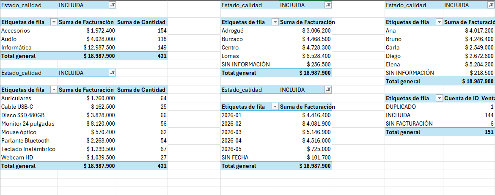

# Project 2 — Sales Analysis and Dashboard in Excel

*Versión en español más abajo / Spanish version below → [Ir a la versión en español](#proyecto-2--análisis-de-ventas-y-dashboard-en-excel)*

⬅️ [Back to the portfolio / Volver al portfolio](../README.md) — Project 2 of 5 / Proyecto 2 de 5

---

## 🇬🇧 English

### Overview

Management of a fictional commercial company wants to know how the business is performing. The starting point is the clean sales base from [Project 1](../01-excel-data-cleaning/). The goal was a **one-page dashboard** whose every number can be traced to a rule, and where the data left out of the totals is reported instead of hidden.

> The dataset is fictional and was created for practice. It does not represent any real company.

### The rule that drove every decision

**Decide how to treat the problem rows before building any table.** The rules were written down first (sheet `reglas`), so the dashboard does not depend on what looked convenient at the moment.

| # | Case | Rule | Rows |
|---|---|---|---|
| 1 | No quantity or no price | Left out of revenue, units, sales and average ticket, and reported separately | 6 |
| 2 | Repeated ID (`V0041`) | Counted once, keeping the first occurrence (01/02/2026) | 1 |
| 3 | Empty branch or seller | Grouped as `SIN INFORMACIÓN` and still counted | 4 |
| 4 | Sales without a date | Included in the totals, shown as `SIN FECHA` in the monthly view and left out of the monthly chart | 2 |
| 5 | May 2026 | Only one sale, so it is highlighted as a partial month | 1 |
| 6 | Units | Counted only from rows that enter the revenue, so units, sales and ticket use the same set of rows | 2 |

The counts in the `reglas` sheet are formulas, not typed numbers, and the dashboard's data-quality note reads them from there.

### Metrics

All four metrics use the same set of rows: the **144** rows with status `INCLUIDA`.

| Metric | Definition | Value |
|---|---|---|
| Total revenue | Sum of quantity × unit price | $18,987,900 |
| Units sold | Sum of quantity | 421 |
| Number of sales | Count of sales (each `ID_Venta` is one sale) | 144 |
| Average ticket | Total revenue ÷ number of sales | $131,860 |

The 151 clean rows split into `INCLUIDA` (144), `SIN FACTURACIÓN` (6) and `DUPLICADO` (1).

### Process

| Step | Task | How |
|---|---|---|
| 1 | Prepare the analysis base | The clean data is loaded as a table (`tblAnalisis`) and the original is kept untouched in its own sheet. Calculated columns are added without overwriting any original column |
| 2 | Write the rules | Sheet `reglas`: one table of rules with live row counts and one table of metric definitions |
| 3 | Calculated columns | Revenue (`IF`, `AND`, `ISNUMBER`), month as `yyyy-mm` text (`TEXT`), `SIN INFORMACIÓN` labels, a running `COUNTIF($A$2:A2, A2)` to detect repeated IDs, and a quality status |
| 4 | PivotTables | Six control tables (month, category, product, branch, seller, quality status), all filtered to `INCLUIDA` |
| 5 | Charts | Five PivotCharts. Each one is built from a dedicated copy of its PivotTable with a single value, because a PivotChart plots every value field of its table |
| 6 | Dashboard | KPI cards read from a PivotTable with `GETPIVOTDATA`, three slicers connected to six PivotTables, five charts and a data-quality note |
| 7 | Validate | Every PivotTable total is compared against the metric defined in `reglas` |

### Dashboard

- **Title and subtitle**, with the period and a note that May is a partial month.
- **Four KPI cards:** total revenue, units, number of sales and average ticket.
- **Three slicers:** category, branch and seller. They filter the KPI cards and the five charts together.
- **Five charts:** revenue by month, by category, by product, by branch and by seller.
- **Data-quality note** at the bottom, built with formulas that read the `reglas` sheet. It describes the whole base and does not change with the slicers.

### Findings

*(Fictional data, shown to illustrate the kind of reading the dashboard allows.)*

- **Revenue is concentrated in one product.** The 24" monitor is 42.8% of revenue with 13.3% of the units. Monitor and SSD together are 62.9%.
- **Units and revenue tell different stories by category.** Computing is 68.4% of revenue with 35.4% of the units; accessories are 36.6% of the units but only 10.4% of revenue.
- **Lomas is the largest branch** (34.4% of revenue). The average ticket is similar across branches, between $124,125 and $139,068, so the difference comes from the number of sales.
- **Elena leads in sales** (27.8% of revenue) and has the highest average ticket among sellers ($150,977). Carla and Diego are the lowest.
- **No clear monthly trend.** From January to April the number of sales is stable (34 to 37 per month) and revenue moves with the product mix. March is the best full month ($5,146,900) and February the lowest ($4,081,900). May has a single sale, so no conclusion is drawn from it.

### Screenshots

**Dashboard** — KPI cards, slicers, five charts and the data-quality note:

**Rules and metrics** — decisions written down before building, with live row counts:

**PivotTables** — control tables whose totals match the metrics:

### Files

| File | Description |
|---|---|
| [`data/Proyecto_2_Analisis_Ventas_Excel.xlsx`](data/Proyecto_2_Analisis_Ventas_Excel.xlsx) | Final workbook (see sheets below) |

Workbook sheets: `datos_limpios_original` (untouched copy), `datos_limpios_corrección` (table `tblAnalisis` with the calculated columns), `reglas` (rules and metric definitions), `Tabla_dinamicas` (six control PivotTables), `Base_graficos` (PivotTables behind the charts and the KPI cards) and `Dashboard`.

### Limitations

- The data enters the workbook through Power Query from the `datos_limpios.csv` file of Project 1. If that file is moved, *Refresh All* fails.
- The data covers January to April 2026 plus one sale in May, so monthly trends are limited to four months.
- Slicers and PivotCharts need Excel for Windows or Mac; they do not work in every viewer.

### Skills demonstrated

PivotTables and PivotCharts · slicers connected to several tables · `GETPIVOTDATA`, `IFERROR` · `SUMIFS`, `COUNTIF`, `IF`, `AND`, `ISNUMBER`, `TEXT` · calculated columns in Excel tables · turning a business question into a metric · defining the treatment of problem data before analyzing · dashboard layout · reconciling every total against a control value.

---

## 🇪🇸 Español

# Proyecto 2 — Análisis de ventas y dashboard en Excel

### Resumen

La dirección de una empresa comercial ficticia quiere saber cómo le va al negocio. El punto de partida es la base de ventas limpia del [Proyecto 1](../01-excel-data-cleaning/). El objetivo fue un **dashboard de una página** donde cada número se pueda rastrear hasta una regla, y donde los datos que quedan fuera de los totales se informen en lugar de esconderse.

> El dataset es ficticio y fue creado para practicar. No representa a ninguna empresa real.

### La regla que guió cada decisión

**Decidir cómo se tratan las filas problemáticas antes de armar cualquier tabla.** Las reglas se escribieron primero (hoja `reglas`), para que el dashboard no dependa de lo que resultaba cómodo en el momento.

| N° | Caso | Regla | Filas |
|---|---|---|---|
| 1 | Sin cantidad o sin precio | Quedan fuera de la facturación, las unidades, las ventas y el ticket promedio, y se informan aparte | 6 |
| 2 | ID repetido (`V0041`) | Cuenta una sola vez, con la primera aparición (01/02/2026) | 1 |
| 3 | Sucursal o vendedor vacíos | Se agrupan como `SIN INFORMACIÓN` y siguen contando | 4 |
| 4 | Ventas sin fecha | Entran en los totales, figuran como `SIN FECHA` en la vista por mes y quedan fuera del gráfico mensual | 2 |
| 5 | Mayo de 2026 | Tiene una sola venta, por eso se destaca como mes parcial | 1 |
| 6 | Unidades | Se cuentan solo de las filas que entran en la facturación, para que unidades, ventas y ticket usen el mismo conjunto de filas | 2 |

Los conteos de la hoja `reglas` son fórmulas, no números escritos a mano, y la nota de calidad del dashboard los lee desde ahí.

### Métricas

Las cuatro métricas usan el mismo conjunto de filas: las **144** con estado `INCLUIDA`.

| Métrica | Definición | Valor |
|---|---|---|
| Facturación total | Suma de cantidad × precio unitario | $18.987.900 |
| Unidades vendidas | Suma de cantidad | 421 |
| Cantidad de ventas | Conteo de ventas (cada `ID_Venta` es una venta) | 144 |
| Ticket promedio | Facturación total ÷ cantidad de ventas | $131.860 |

Las 151 filas limpias se reparten en `INCLUIDA` (144), `SIN FACTURACIÓN` (6) y `DUPLICADO` (1).

### Proceso

| Paso | Tarea | Cómo |
|---|---|---|
| 1 | Preparar la base de análisis | Los datos limpios se cargan como tabla (`tblAnalisis`) y el original se conserva sin tocar en su propia hoja. Las columnas calculadas se agregan sin pisar ninguna columna original |
| 2 | Escribir las reglas | Hoja `reglas`: una tabla de reglas con conteos de filas en vivo y una tabla con la definición de cada métrica |
| 3 | Columnas calculadas | Facturación (`SI`, `Y`, `ESNUMERO`), mes como texto `aaaa-mm` (`TEXTO`), etiquetas `SIN INFORMACIÓN`, un `CONTAR.SI($A$2:A2; A2)` acumulado para detectar IDs repetidos y un estado de calidad |
| 4 | Tablas dinámicas | Seis tablas de control (mes, categoría, producto, sucursal, vendedor y estado de calidad), todas filtradas a `INCLUIDA` |
| 5 | Gráficos | Cinco gráficos dinámicos. Cada uno sale de una copia propia de su tabla con un solo valor, porque un gráfico dinámico dibuja todos los campos de valores de su tabla |
| 6 | Dashboard | Tarjetas leídas de una tabla dinámica con `OBTENERDATOSDINAMICOS`, tres segmentaciones conectadas a seis tablas, cinco gráficos y una nota de calidad de datos |
| 7 | Validar | El total de cada tabla dinámica se compara contra la métrica definida en `reglas` |

### Dashboard

- **Título y subtítulo**, con el período y la aclaración de que mayo es un mes parcial.
- **Cuatro tarjetas:** facturación total, unidades, cantidad de ventas y ticket promedio.
- **Tres segmentaciones:** categoría, sucursal y vendedor. Filtran a la vez las tarjetas y los cinco gráficos.
- **Cinco gráficos:** facturación por mes, por categoría, por producto, por sucursal y por vendedor.
- **Nota de calidad de datos** al pie, armada con fórmulas que leen la hoja `reglas`. Describe toda la base y no cambia con las segmentaciones.

### Hallazgos

*(Datos ficticios, para ilustrar el tipo de lectura que permite el dashboard.)*

- **La facturación se concentra en un producto.** El monitor de 24" es el 42,8 % de la facturación con el 13,3 % de las unidades. Monitor y SSD juntos son el 62,9 %.
- **Unidades y facturación cuentan historias distintas por categoría.** Informática es el 68,4 % de la facturación con el 35,4 % de las unidades; accesorios es el 36,6 % de las unidades pero solo el 10,4 % de la facturación.
- **Lomas es la sucursal más grande** (34,4 % de la facturación). El ticket promedio es parecido entre sucursales, entre $124.125 y $139.068, así que la diferencia viene de la cantidad de ventas.
- **Elena lidera en ventas** (27,8 % de la facturación) y tiene el ticket promedio más alto entre los vendedores ($150.977). Carla y Diego son los más bajos.
- **No hay una tendencia mensual clara.** De enero a abril la cantidad de ventas es estable (34 a 37 por mes) y la facturación se mueve con la mezcla de productos. Marzo es el mejor mes completo ($5.146.900) y febrero el más bajo ($4.081.900). Mayo tiene una sola venta, por eso no se saca ninguna conclusión de ese mes.

### Capturas

**Dashboard** — tarjetas, segmentaciones, cinco gráficos y la nota de calidad de datos:

**Reglas y métricas** — decisiones escritas antes de construir, con conteos de filas en vivo:

**Tablas dinámicas** — tablas de control cuyos totales coinciden con las métricas:

### Archivos

| Archivo | Descripción |
|---|---|
| [`data/Proyecto_2_Analisis_Ventas_Excel.xlsx`](data/Proyecto_2_Analisis_Ventas_Excel.xlsx) | Libro final (hojas abajo) |

Hojas del libro: `datos_limpios_original` (copia sin tocar), `datos_limpios_corrección` (tabla `tblAnalisis` con las columnas calculadas), `reglas` (reglas y definición de métricas), `Tabla_dinamicas` (seis tablas dinámicas de control), `Base_graficos` (tablas detrás de los gráficos y de las tarjetas) y `Dashboard`.

### Limitaciones

- Los datos entran al libro con Power Query desde el archivo `datos_limpios.csv` del Proyecto 1. Si ese archivo se mueve, *Actualizar todo* da error.
- Los datos abarcan de enero a abril de 2026 más una venta en mayo, así que las tendencias mensuales se limitan a cuatro meses.
- Las segmentaciones y los gráficos dinámicos necesitan Excel para Windows o Mac; no funcionan en todos los visores.

### Habilidades aplicadas

Tablas y gráficos dinámicos · segmentaciones conectadas a varias tablas · `OBTENERDATOSDINAMICOS`, `SI.ERROR` · `SUMAR.SI.CONJUNTO`, `CONTAR.SI`, `SI`, `Y`, `ESNUMERO`, `TEXTO` · columnas calculadas en tablas de Excel · traducir una pregunta de negocio a una métrica · definir el tratamiento de los datos problemáticos antes de analizar · diseño de dashboards · conciliar cada total contra un valor de control.
