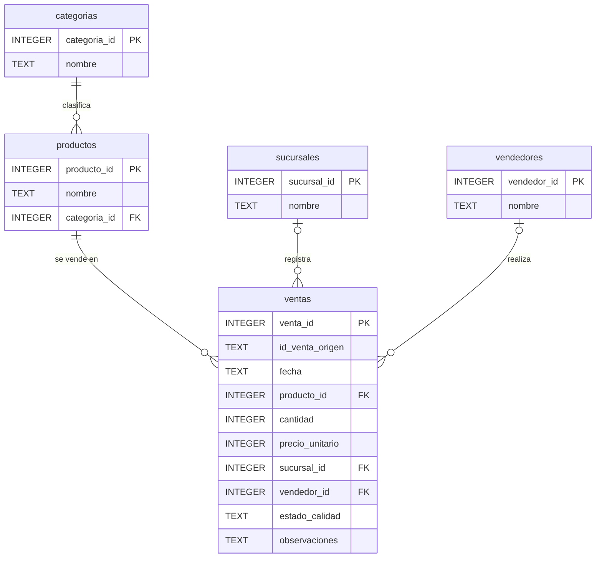
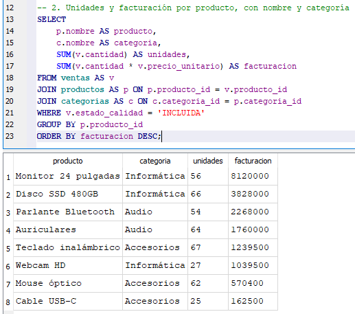
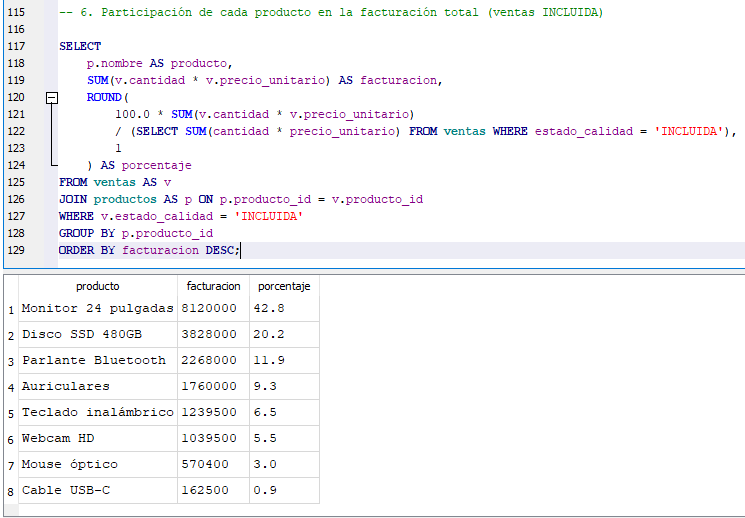
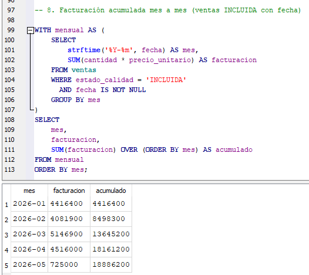

# Project 3 — Sales Analysis with SQL

*Versión en español más abajo / Spanish version below → [Ir a la versión en español](#proyecto-3--análisis-de-ventas-con-sql)*

⬅️ [Back to the portfolio / Volver al portfolio](../README.md) — Project 3 of 5 / Proyecto 3 de 5

---

## 🇬🇧 English

### Overview

The same fictional commercial company from Projects 1 and 2 now needs its sales data in a database. The starting point is the clean sales base from [Project 1](../01-excel-data-cleaning/), which is the same data analysed in [Project 2](../02-excel-analysis-dashboard/). The goal was to move from one flat table to a **relational model** in SQLite, answer business questions with SQL, and **reconcile every result against the Excel dashboard**.

> The dataset is fictional and was created for practice. It does not represent any real company.

### The rule that drove every decision

**Load every row and mark the problem ones instead of deleting them.** Nothing from the clean base was removed. A `estado_calidad` column records how each row is treated, and every business query filters on it. That keeps the data complete and makes the rules visible in the `WHERE` clause.

| # | Case | Decision in the database | Rows |
|---|---|---|---|
| 1 | No quantity or no price | Loaded with `NULL`, status `SIN FACTURACIÓN`, left out of every metric | 6 |
| 2 | Repeated ID (`V0041`) | Both rows kept, because the key is a numeric `venta_id` and the business ID is stored apart in `id_venta_origen`. The second occurrence (05/04/2026) is marked `DUPLICADO` | 1 |
| 3 | Empty branch or seller | Stored as `NULL` in the foreign key, shown as `Sin sucursal` / `Sin vendedor` with `LEFT JOIN` + `COALESCE`, still counted | 4 |
| 4 | Sales without a date | Stored as `NULL`, shown as `Sin fecha` in the monthly view, left out of the cumulative view | 2 |
| 5 | Dates as `dd/mm/yyyy` | Converted to `yyyy-mm-dd`, the format SQLite sorts and filters correctly | 149 |
| 6 | May 2026 | Only one sale, so it is treated as a partial month | 1 |

### Data model

| Table | Content | Key columns |
|---|---|---|
| `categorias` | 3 product categories | `categoria_id` (PK) |
| `productos` | 8 products | `producto_id` (PK), `categoria_id` (FK) |
| `sucursales` | 4 branches | `sucursal_id` (PK) |
| `vendedores` | 5 sellers | `vendedor_id` (PK) |
| `ventas` | 151 sales rows | `venta_id` (PK), `producto_id`, `sucursal_id` and `vendedor_id` (FK), `estado_calidad` |

- `precio_unitario` stays in `ventas` and not in `productos`: it is the price charged on that sale, so a later price change cannot rewrite past sales.
- The category is not repeated in `ventas`: it is reached through the product.
- `sucursal_id` and `vendedor_id` allow `NULL`, because some sales have no branch or seller. A seller is not tied to one branch: the same seller sold in several, and that relationship lives in `ventas`.

### Process

| Step | Task | How |
|---|---|---|
| 1 | Choose the tools | SQLite with DB Browser for SQLite: free, no server, and the `.db` file goes in the repo |
| 2 | Design the model | From one flat table to five related tables, with primary and foreign keys |
| 3 | Create the tables | `sql/01_crear_tablas.sql`, created in dependency order (`categorias` before `productos`, all of them before `ventas`) |
| 4 | Load the lookup tables | `INSERT` of categories, branches, sellers and products, with the category looked up by its ID |
| 5 | Load the sales | The CSV is imported as a temporary table (`ventas_raw`) and moved to `ventas` with one `INSERT ... SELECT` that replaces names with IDs (`JOIN`), converts dates, turns blanks into `NULL` and computes `estado_calidad` |
| 6 | Validate | Row counts and totals compared against Project 2 (table below). The temporary table is then dropped |
| 7 | Business queries | Eight queries, from simple to advanced, in `sql/03_consultas_negocio.sql` |

### Validation against Excel

| Control | Excel (Project 2) | SQL |
|---|---|---|
| Rows by status | 144 / 6 / 1 | 144 `INCLUIDA` / 6 `SIN FACTURACIÓN` / 1 `DUPLICADO` |
| Number of sales | 144 | 144 |
| Units sold | 421 | 421 |
| Total revenue | $18,987,900 | $18,987,900 |
| Monitor share of revenue | 42.8% | 42.8% |
| Revenue of the largest branch (Lomas) | 34.4% | 34.4% |

### Queries

All metrics use the same set of rows: the **144** with status `INCLUIDA`.

| # | Business question | SQL concepts |
|---|---|---|
| 1 | Units and revenue by product | `SUM`, `WHERE`, `GROUP BY`, `ORDER BY` |
| 2 | The same, with product and category names | `JOIN` (two chained) |
| 3 | Revenue by branch, without losing sales that have no branch | `LEFT JOIN`, `COALESCE`, `COUNT` |
| 4 | Revenue by seller | `LEFT JOIN`, `COALESCE` |
| 5 | Revenue by month | `strftime`, `GROUP BY` on a calculated column |
| 6 | Each product's share of total revenue | Subquery, `ROUND` |
| 7 | Product ranking inside its category | Window function: `RANK() OVER (PARTITION BY ...)` |
| 8 | Cumulative revenue month by month | CTE (`WITH`) and `SUM() OVER (ORDER BY ...)` |

### Findings

*(Fictional data, shown to illustrate the kind of reading the queries allow.)*

- **Revenue is concentrated in one product.** The 24" monitor is 42.8% of revenue with 13.3% of the units. Monitor and SSD together are 62.9%.
- **Units and revenue tell different stories.** The wireless keyboard is the product with the most units (67) but brings 6.5% of revenue. Inside each category the leader by revenue is the monitor (computing), the wireless keyboard (accessories) and the Bluetooth speaker (audio).
- **Lomas is the largest branch** ($6,528,400, 34.4% of revenue). The average ticket is similar across branches, between $124,125 and $139,068, so the difference comes from the number of sales (49 in Lomas against 23 to 36 elsewhere).
- **Elena leads in revenue** ($5,284,200, 27.8%) and has the highest average ticket among sellers ($150,977), followed by Bruno (22.4%).
- **No clear monthly trend.** From January to April the number of sales is stable (34 to 37 per month) and revenue moves with the product mix. March is the best full month ($5,146,900) and February the lowest ($4,081,900). May has a single sale, so no conclusion is drawn from it.
- **Cumulative revenue** reaches $18,886,200 in May. It does not reach the $18,987,900 total because $101,700 comes from two sales without a date.

### Screenshots

**Revenue and units by product** — query 2, with names and categories:

**Share of total revenue by product** — query 6, with a subquery:

**Cumulative revenue by month** — query 8, with a CTE and a window function:

### Files

| File | Description |
|---|---|
| [`ventas.db`](ventas.db) | SQLite database with the five tables loaded |
| [`data/datos_limpios.csv`](data/datos_limpios.csv) | Clean base from Project 1 (UTF-8, comma separated) |
| [`sql/01_crear_tablas.sql`](sql/01_crear_tablas.sql) | Creates the five tables |
| [`sql/02_cargar_datos.sql`](sql/02_cargar_datos.sql) | Loads the lookup tables and the sales |
| [`sql/03_consultas_negocio.sql`](sql/03_consultas_negocio.sql) | The eight business queries |

**To rebuild the database:** create an empty database in DB Browser for SQLite, run `01_crear_tablas.sql`, import `data/datos_limpios.csv` as a table named `ventas_raw` (*File → Import → Table from CSV file*, UTF-8, comma), run `02_cargar_datos.sql`, then drop `ventas_raw`.

### Limitations

- The `DUPLICADO` rule is written for one ID: the `CASE` checks `ID_Venta = 'V0041'` and its date. A general version would number repeated IDs with `ROW_NUMBER() OVER (PARTITION BY ID_Venta ORDER BY ...)`.
- SQLite has no date type, so dates are stored as text in `yyyy-mm-dd` format.
- The CSV import is a manual step in DB Browser, so the database cannot be rebuilt with a single script.
- The data covers January to April 2026 plus one sale in May, so monthly trends are limited to four months.
- The original quantity of `V0063` (a negative value in the source) was already lost in Project 1, so it is loaded as `NULL`.

### Skills demonstrated

Relational modelling (normalization, primary and foreign keys, `NOT NULL`) · `CREATE TABLE`, `INSERT`, `INSERT ... SELECT` · `JOIN` and `LEFT JOIN` · `GROUP BY`, `SUM`, `COUNT` · `CASE`, `COALESCE`, `NULLIF`, `TRIM` · `substr` and `strftime` for dates · subqueries · CTEs · window functions (`RANK`, `SUM OVER`) · treating problem data without deleting it · reconciling every result against a control value.

---

## 🇪🇸 Español

# Proyecto 3 — Análisis de ventas con SQL

### Resumen

La misma empresa comercial ficticia de los Proyectos 1 y 2 ahora necesita sus datos de ventas en una base de datos. El punto de partida es la base de ventas limpia del [Proyecto 1](../01-excel-data-cleaning/), los mismos datos que se analizaron en el [Proyecto 2](../02-excel-analysis-dashboard/). El objetivo fue pasar de una tabla plana a un **modelo relacional** en SQLite, responder preguntas de negocio con SQL y **conciliar cada resultado con el dashboard de Excel**.

> El dataset es ficticio y fue creado para practicar. No representa a ninguna empresa real.

### La regla que guió cada decisión

**Cargar todas las filas y marcar las problemáticas en lugar de borrarlas.** No se eliminó nada de la base limpia. Una columna `estado_calidad` registra cómo se trata cada fila, y todas las consultas de negocio filtran por ella. Así los datos quedan completos y las reglas se ven en el `WHERE`.

| N° | Caso | Decisión en la base | Filas |
|---|---|---|---|
| 1 | Sin cantidad o sin precio | Se cargan con `NULL`, estado `SIN FACTURACIÓN`, y quedan fuera de todas las métricas | 6 |
| 2 | ID repetido (`V0041`) | Se conservan las dos filas, porque la clave es un `venta_id` numérico y el ID del negocio se guarda aparte en `id_venta_origen`. La segunda aparición (05/04/2026) se marca como `DUPLICADO` | 1 |
| 3 | Sucursal o vendedor vacíos | Quedan como `NULL` en la clave foránea, se muestran como `Sin sucursal` / `Sin vendedor` con `LEFT JOIN` + `COALESCE` y siguen contando | 4 |
| 4 | Ventas sin fecha | Quedan como `NULL`, figuran como `Sin fecha` en la vista por mes y quedan fuera de la vista acumulada | 2 |
| 5 | Fechas `dd/mm/aaaa` | Se convierten a `aaaa-mm-dd`, el formato que SQLite ordena y filtra bien | 149 |
| 6 | Mayo de 2026 | Tiene una sola venta, por eso se trata como mes parcial | 1 |

### Modelo de datos

| Tabla | Contenido | Columnas clave |
|---|---|---|
| `categorias` | 3 categorías de producto | `categoria_id` (PK) |
| `productos` | 8 productos | `producto_id` (PK), `categoria_id` (FK) |
| `sucursales` | 4 sucursales | `sucursal_id` (PK) |
| `vendedores` | 5 vendedores | `vendedor_id` (PK) |
| `ventas` | 151 filas de ventas | `venta_id` (PK), `producto_id`, `sucursal_id` y `vendedor_id` (FK), `estado_calidad` |

- `precio_unitario` queda en `ventas` y no en `productos`: es el precio cobrado en esa venta, así que un cambio de precio posterior no reescribe las ventas pasadas.
- La categoría no se repite en `ventas`: se llega a ella a través del producto.
- `sucursal_id` y `vendedor_id` admiten `NULL`, porque algunas ventas no tienen sucursal o vendedor. Un vendedor no pertenece a una sola sucursal: el mismo vendedor vendió en varias, y esa relación vive en `ventas`.

### Proceso

| Paso | Tarea | Cómo |
|---|---|---|
| 1 | Elegir las herramientas | SQLite con DB Browser for SQLite: gratis, sin servidor, y el archivo `.db` se sube al repo |
| 2 | Diseñar el modelo | De una tabla plana a cinco tablas relacionadas, con claves primarias y foráneas |
| 3 | Crear las tablas | `sql/01_crear_tablas.sql`, creadas en orden de dependencia (`categorias` antes de `productos`, todas antes de `ventas`) |
| 4 | Cargar las tablas de apoyo | `INSERT` de categorías, sucursales, vendedores y productos, con la categoría buscada por su ID |
| 5 | Cargar las ventas | El CSV se importa como tabla temporal (`ventas_raw`) y se pasa a `ventas` con un `INSERT ... SELECT` que reemplaza nombres por IDs (`JOIN`), convierte las fechas, transforma los vacíos en `NULL` y calcula `estado_calidad` |
| 6 | Validar | Conteos y totales comparados contra el Proyecto 2 (tabla abajo). Después se elimina la tabla temporal |
| 7 | Consultas de negocio | Ocho consultas, de simples a avanzadas, en `sql/03_consultas_negocio.sql` |

### Validación contra Excel

| Control | Excel (Proyecto 2) | SQL |
|---|---|---|
| Filas por estado | 144 / 6 / 1 | 144 `INCLUIDA` / 6 `SIN FACTURACIÓN` / 1 `DUPLICADO` |
| Cantidad de ventas | 144 | 144 |
| Unidades vendidas | 421 | 421 |
| Facturación total | $18.987.900 | $18.987.900 |
| Participación del monitor en la facturación | 42,8 % | 42,8 % |
| Facturación de la sucursal más grande (Lomas) | 34,4 % | 34,4 % |

### Consultas

Todas las métricas usan el mismo conjunto de filas: las **144** con estado `INCLUIDA`.

| N° | Pregunta de negocio | Conceptos de SQL |
|---|---|---|
| 1 | Unidades y facturación por producto | `SUM`, `WHERE`, `GROUP BY`, `ORDER BY` |
| 2 | Lo mismo, con el nombre del producto y la categoría | `JOIN` (dos encadenados) |
| 3 | Facturación por sucursal, sin perder las ventas que no tienen sucursal | `LEFT JOIN`, `COALESCE`, `COUNT` |
| 4 | Facturación por vendedor | `LEFT JOIN`, `COALESCE` |
| 5 | Facturación por mes | `strftime`, `GROUP BY` sobre una columna calculada |
| 6 | Participación de cada producto en la facturación total | Subconsulta, `ROUND` |
| 7 | Ranking de productos dentro de su categoría | Función de ventana: `RANK() OVER (PARTITION BY ...)` |
| 8 | Facturación acumulada mes a mes | CTE (`WITH`) y `SUM() OVER (ORDER BY ...)` |

### Hallazgos

*(Datos ficticios, para ilustrar el tipo de lectura que permiten las consultas.)*

- **La facturación se concentra en un producto.** El monitor de 24" es el 42,8 % de la facturación con el 13,3 % de las unidades. Monitor y SSD juntos son el 62,9 %.
- **Unidades y facturación cuentan historias distintas.** El teclado inalámbrico es el producto con más unidades (67) pero aporta el 6,5 % de la facturación. Dentro de cada categoría, el líder en facturación es el monitor (informática), el teclado inalámbrico (accesorios) y el parlante Bluetooth (audio).
- **Lomas es la sucursal más grande** ($6.528.400, 34,4 % de la facturación). El ticket promedio es parecido entre sucursales, entre $124.125 y $139.068, así que la diferencia viene de la cantidad de ventas (49 en Lomas contra 23 a 36 en las demás).
- **Elena lidera en facturación** ($5.284.200, 27,8 %) y tiene el ticket promedio más alto entre los vendedores ($150.977), seguida por Bruno (22,4 %).
- **No hay una tendencia mensual clara.** De enero a abril la cantidad de ventas es estable (34 a 37 por mes) y la facturación se mueve con la mezcla de productos. Marzo es el mejor mes completo ($5.146.900) y febrero el más bajo ($4.081.900). Mayo tiene una sola venta, por eso no se saca ninguna conclusión de ese mes.
- **La facturación acumulada** llega a $18.886.200 en mayo. No alcanza los $18.987.900 del total porque $101.700 corresponden a dos ventas sin fecha.

### Capturas

**Facturación y unidades por producto** — consulta 2, con nombres y categorías:

**Participación de cada producto en la facturación total** — consulta 6, con una subconsulta:

**Facturación acumulada por mes** — consulta 8, con una CTE y una función de ventana:

### Archivos

| Archivo | Descripción |
|---|---|
| [`ventas.db`](ventas.db) | Base SQLite con las cinco tablas cargadas |
| [`data/datos_limpios.csv`](data/datos_limpios.csv) | Base limpia del Proyecto 1 (UTF-8, separada por comas) |
| [`sql/01_crear_tablas.sql`](sql/01_crear_tablas.sql) | Crea las cinco tablas |
| [`sql/02_cargar_datos.sql`](sql/02_cargar_datos.sql) | Carga las tablas de apoyo y las ventas |
| [`sql/03_consultas_negocio.sql`](sql/03_consultas_negocio.sql) | Las ocho consultas de negocio |

**Para reconstruir la base:** crear una base vacía en DB Browser for SQLite, ejecutar `01_crear_tablas.sql`, importar `data/datos_limpios.csv` como tabla `ventas_raw` (*File → Import → Table from CSV file*, UTF-8, coma), ejecutar `02_cargar_datos.sql` y después eliminar `ventas_raw`.

### Limitaciones

- La regla de `DUPLICADO` está escrita para un solo ID: el `CASE` revisa `ID_Venta = 'V0041'` y su fecha. Una versión general numeraría los IDs repetidos con `ROW_NUMBER() OVER (PARTITION BY ID_Venta ORDER BY ...)`.
- SQLite no tiene un tipo fecha, así que las fechas se guardan como texto en formato `aaaa-mm-dd`.
- La importación del CSV es un paso manual en DB Browser, por lo que la base no se reconstruye con un solo script.
- Los datos abarcan de enero a abril de 2026 más una venta en mayo, así que las tendencias mensuales se limitan a cuatro meses.
- La cantidad original de `V0063` (un valor negativo en el origen) ya se había perdido en el Proyecto 1, por eso se carga como `NULL`.

### Habilidades aplicadas

Modelado relacional (normalización, claves primarias y foráneas, `NOT NULL`) · `CREATE TABLE`, `INSERT`, `INSERT ... SELECT` · `JOIN` y `LEFT JOIN` · `GROUP BY`, `SUM`, `COUNT` · `CASE`, `COALESCE`, `NULLIF`, `TRIM` · `substr` y `strftime` para fechas · subconsultas · CTE · funciones de ventana (`RANK`, `SUM OVER`) · tratar datos problemáticos sin borrarlos · conciliar cada resultado contra un valor de control.
